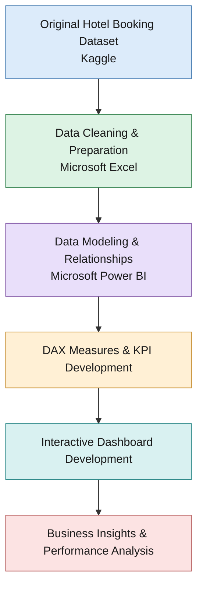

# Hotel Revenue & Booking Performance Analysis | Power BI

An end-to-end Data Analytics project using Microsoft Excel and Power BI.

## Project Overview

This project analyzes hotel booking and revenue data to evaluate financial performance, booking trends, occupancy, and property performance. It uses Excel for data preparation and Power BI for interactive reporting and business analysis.

## Business Objectives

- Analyze revenue generated versus revenue realized.
- Identify revenue gaps and booking losses.
- Evaluate hotel occupancy and booking performance.
- Compare revenue across properties, cities, and booking platforms.
- Present actionable business insights through interactive dashboards.

## Tools & Technologies

- Microsoft Excel: Data preparation and cleaning.
- Microsoft Power BI: Data modeling, DAX measures, and dashboard development.

## Dataset Information

Source: Kaggle – Hotel Booking and Revenue Dataset

The cleaned Excel workbook contains five sheets:

| Sheet Name | Records |
|---|---:|
| fact_bookings | 134,590 |
| dim_rooms | 4 |
| dim_hotels | 25 |
| dim_date | 92 |
| fact_aggregated_bookings | 9,200 |

 Analysis Period: May–July 2022

## Data Preparation

- Reviewed the Kaggle dataset and its existing structure.
- Performed additional data cleaning and preparation in Excel.
- Standardized selected column names.
- Corrected the rating field to a 1–5 scale.
- Checked missing values and duplicate records.
- Organized data into fact and dimension tables for Power BI analysis.

## Power BI Dashboard

The report contains five interactive pages:

1. Executive Overview – Overall hotel performance and KPIs.
2. Revenue & Financial Performance – Revenue generated, revenue realized, and revenue gap.
3. Booking & Property Performance – Booking status, occupancy, room classes, and property analysis.
4. Booking Loss and Recovery Insights – Unsuccessful bookings and potential revenue at risk.
5. Drill Through Analysis – Detailed property, city, and booking-platform performance.

## Key Performance Indicators

- Revenue Generated
- Revenue Realized
- Revenue Gap
- Revenue Realization %
- Successful Bookings
- Unsuccessful Bookings
- Booking Loss Rate
- Occupancy Rate
- Potential Revenue at Risk
- Average Guest Rating

## Key Business Insights

| Business Area | Key Finding |
|---|---|
| Revenue Performance | Generated revenue was approximately ₹201 Cr, while realized revenue was approximately ₹171 Cr. |
| Revenue Gap | Identified a revenue gap of approximately ₹29.88 Cr, with an 85.12% revenue realization rate. |
| Booking Status | 70.15% bookings were checked out, 24.83% cancelled, and 5.02% no-shows. |
| City Performance | Mumbai recorded the highest realized revenue (approximately ₹66.86 Cr). |
| Property Performance | Atliq Exotica generated the highest realized revenue (approximately ₹32.03 Cr). |
| Booking Platform | The Others category accounted for 40.91% of bookings. |
| Occupancy Trend | Occupancy declined from 58.55% in May to 57.45% in July 2022. |

## Project Workflow

## Key Learnings

- Excel-based data preparation and cleaning.
- Power BI data modeling and visualization.
- KPI development and business performance analysis.
- Interactive dashboard and drill-through functionality.
- Converting raw data into meaningful business insights.

## Conclusion

This project demonstrates the application of Excel and Power BI in analyzing hotel revenue, booking performance, and occupancy. The dashboard provides an interactive approach to understanding hotel business performance and supporting data-driven decisions.

---

## Domain: Travel & Hospitality

## Project Type: Data Analytics & Business Intelligence

## Tools: Microsoft Excel | Microsoft Power BI
